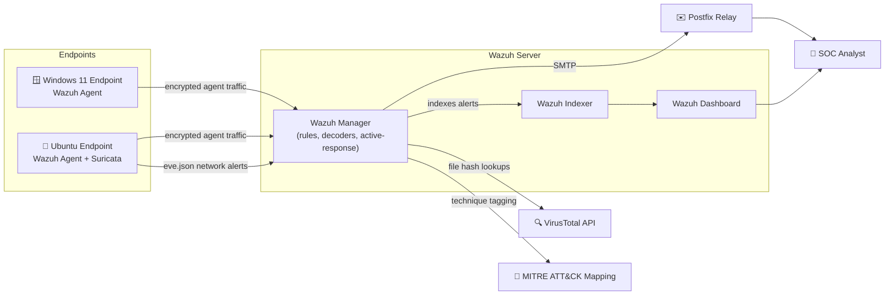
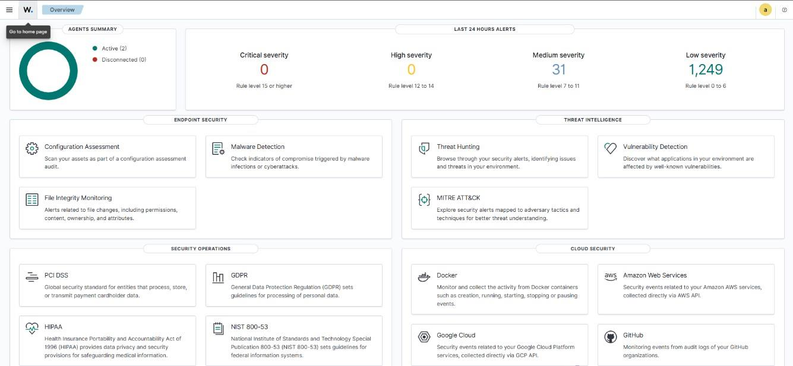
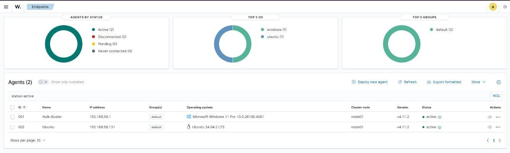
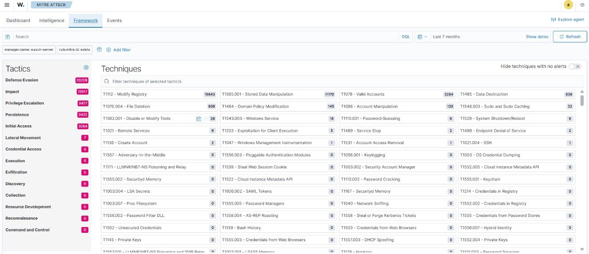
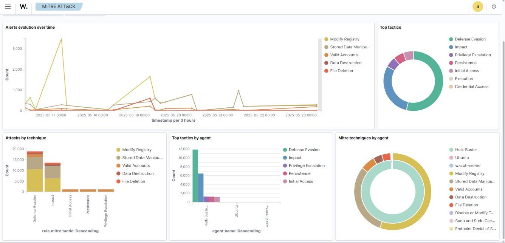
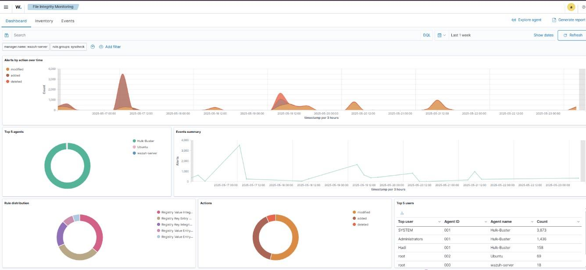
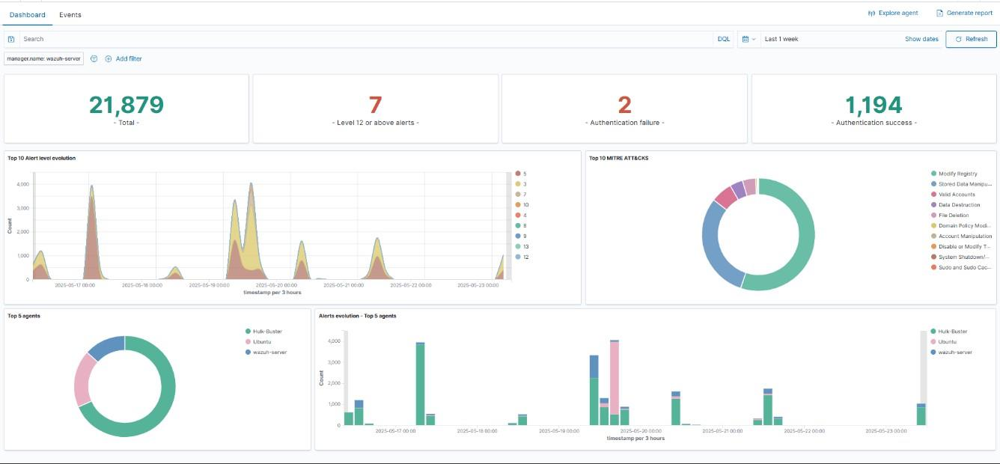
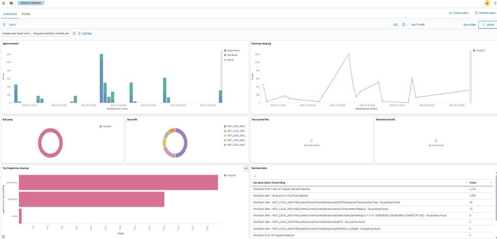
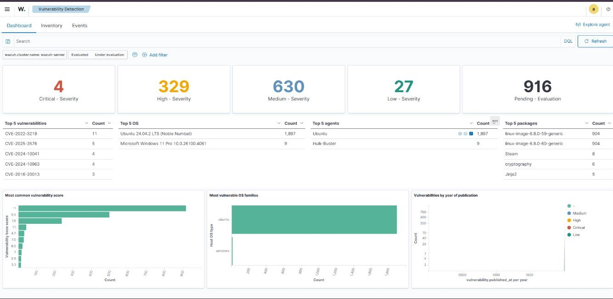
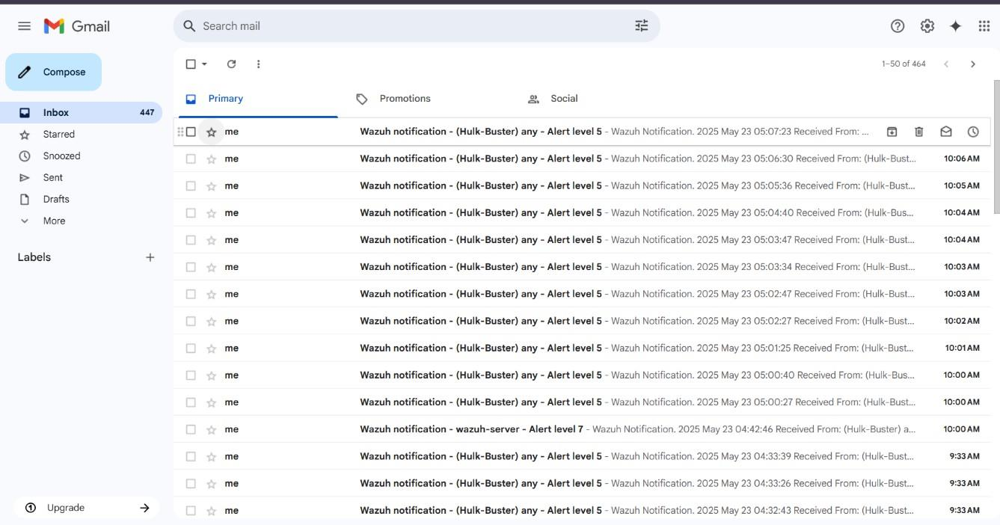

# 🛡️ Advanced Security Monitoring & Incident Response System with Wazuh

A hands-on SIEM/EDR lab that integrates **Wazuh**, **Suricata (NIDS)**, and **VirusTotal**, with detections mapped to the **MITRE ATT&CK** framework — built end-to-end as a Final Year Project and adapted here as a portfolio reference.


---

## 📖 Table of Contents

- [Overview](#-overview)
- [Key Features](#-key-features)
- [Architecture](#-architecture)
- [Tech Stack](#-tech-stack)
- [Screenshots](#-screenshots)
- [Getting Started](#-getting-started)
- [Results & Performance](#-results--performance)
- [Real-World Applications](#-real-world-applications)
- [Skills Demonstrated](#-skills-demonstrated)
- [Project Structure](#-project-structure)
- [Future Work](#-future-work)
- [Authors & Acknowledgments](#-authors--acknowledgments)
- [References](#-references)

---

## 🔍 Overview

Organizations routinely take months to detect a breach (287 days on average, per IBM's 2023 Cost of a Data Breach Report), largely because monitoring tools operate in silos — endpoint logs in one place, network traffic in another, threat intelligence nowhere at all.

This project builds a **unified, open-source security operations stack** on top of **Wazuh** that closes that gap for small teams and labs without an enterprise SIEM budget:

- Centralized **log analysis** and **file integrity monitoring (FIM)** across Windows and Linux endpoints
- **Network intrusion detection** via Suricata, correlated back into the same dashboard
- **Automated malware triage** using the VirusTotal API, with active-response auto-remediation
- **Continuous vulnerability scanning** against NVD/CPE/MSU feeds
- **Threat hunting** and alert classification aligned to **MITRE ATT&CK** tactics & techniques
- **Email alerting** via a Postfix relay for real-time notification

The result is a single pane of glass that takes an analyst from "something happened" to "here's what, where, how bad, and what technique it maps to" — the core workflow of a SOC.

## ✨ Key Features

| Capability | What it does |
|---|---|
| 🖥️ **Multi-OS Agent Monitoring** | Wazuh agents deployed on Windows 11 and Ubuntu endpoints, reporting to a central manager over an encrypted channel |
| 📁 **File Integrity Monitoring** | Real-time monitoring of `/etc`, `/home`, `/var/www`, `/usr/local/bin` (and equivalents) with tuned noise-exclusions |
| 🦠 **Malware Detection** | VirusTotal API integration scans files changed in monitored directories and can auto-remove confirmed threats |
| 🌐 **Network IDS/IPS** | Suricata + the Emerging Threats ruleset inspects live traffic; alerts flow into Wazuh via `eve.json` |
| 🧭 **MITRE ATT&CK Mapping** | Custom detection rules tagged with ATT&CK technique/tactic IDs for structured threat hunting |
| 🔎 **Vulnerability Assessment** | Scheduled scans against NVD/CPE/Microsoft Security Update feeds, filtered by minimum CVSS |
| 🚨 **Automated Incident Response** | Active-response Bash script quarantines/deletes files flagged as malicious |
| 📧 **Email Alerting** | Postfix-relayed SMTP notifications for alerts above a configurable severity threshold |

## 🏗️ Architecture



Full write-up of the data flow: [`docs/architecture.md`](docs/architecture.md)

## 🧰 Tech Stack

| Layer | Tools |
|---|---|
| SIEM / EDR | Wazuh 4.12 — Manager, Indexer, Dashboard, Filebeat |
| Network IDS/IPS | Suricata 6.0.8 + Emerging Threats open ruleset |
| Threat Intelligence | VirusTotal public API |
| Detection Framework | MITRE ATT&CK |
| Mail Transfer Agent | Postfix (Gmail SMTP relay with SASL auth + TLS) |
| Endpoints | Windows 11, Ubuntu 22.04 / 24.04 LTS |
| Scripting / Automation | Bash |
| Vulnerability Feeds | NVD, CPE, Microsoft Security Updates |

## 🖼️ Screenshots

<table>
<tr>
<td width="50%">

**Overview Dashboard**
Agent health, alert severity breakdown, and quick links across endpoint security, threat intel, and compliance modules.



</td>
<td width="50%">

**Managed Endpoints**
Live agent status, OS distribution, and group membership across the monitored fleet.



</td>
</tr>
<tr>
<td width="50%">

**MITRE ATT&CK — Techniques**
Alerts filtered and counted by ATT&CK technique, broken down by tactic (Defense Evasion, Impact, Privilege Escalation, …).



</td>
<td width="50%">

**MITRE ATT&CK — Dashboard**
Alert evolution over time, top tactics, and technique distribution per agent.



</td>
</tr>
<tr>
<td width="50%">

**File Integrity Monitoring**
Real-time file add/modify/delete events, rule distribution, and top users triggering changes.



</td>
<td width="50%">

**Network IDS (Suricata)**
21,879 network alerts analyzed over a 7-day window, with authentication failures and top ATT&CK techniques surfaced automatically.



</td>
</tr>
<tr>
<td width="50%">

**Malware Detection (VirusTotal)**
File-scan results streamed in from the VirusTotal integration, broken down by rule group and source file.



</td>
<td width="50%">

**Vulnerability Detection**
CVE exposure by severity (4 Critical / 329 High / 630 Medium / 27 Low) across the monitored fleet, with top vulnerable packages and OS families.



</td>
</tr>
<tr>
<td width="50%">

**Email Alerting**
Real-time SMTP notifications delivered per alert, relayed through a self-hosted Postfix instance.



</td>
<td width="50%">

</td>
</tr>
</table>

## 🚀 Getting Started

> Full step-by-step walkthrough (server install, agent deployment, all integrations) lives in [`docs/installation-guide.md`](docs/installation-guide.md). Quick summary below.

**Prerequisites**
- A hypervisor (VirtualBox or similar) — Wazuh ships as a ready-made OVA
- 4 CPU cores / 8 GB RAM / 50 GB storage for the Wazuh server VM
- One or more endpoints to monitor (Windows and/or Linux)
- A free [VirusTotal API key](https://www.virustotal.com/) for malware lookups

**1. Stand up the Wazuh server**
```bash
# Import the official Wazuh OVA into VirtualBox, then log in
ssh wazuh-user@<server-ip>   # default password: wazuh
sudo -i
```

**2. Enroll an endpoint**
```bash
# Linux (Ubuntu/Debian)
curl -s https://packages.wazuh.com/key/GPG-KEY-WAZUH | gpg --no-default-keyring \
  --keyring gnupg-ring:/usr/share/keyrings/wazuh.gpg --import
WAZUH_MANAGER="<manager-ip>" apt-get install wazuh-agent
systemctl enable --now wazuh-agent
```
```powershell
# Windows
.\wazuh-agent-4.12.0-1.msi /q WAZUH_MANAGER="<manager-ip>"
NET START Wazuh
```

**3. Wire up the integrations**
Copy the relevant snippet from [`config/ossec-snippets/`](config/ossec-snippets) into `/var/ossec/etc/ossec.conf` on the manager, drop in your own VirusTotal API key, and restart:
```bash
systemctl restart wazuh-manager
```

**4. Deploy the active-response script**
```bash
cp scripts/active-response/remove-threat.sh /var/ossec/active-response/bin/
chmod 750 /var/ossec/active-response/bin/remove-threat.sh
chown root:wazuh /var/ossec/active-response/bin/remove-threat.sh
systemctl restart wazuh-agent
```

Log into the dashboard at `https://<server-ip>` (default `admin` / `admin` on first boot — **change this immediately**) and confirm agents show as **active**.

## 📊 Results & Performance

Measured in the lab environment described in the full report (`FYP-Project.pdf`):

| Metric | Result |
|---|---|
| Average alert generation → propagation time | **~2.3 seconds** |
| CPU utilization under peak load | 40–60% |
| Average memory utilization | 55% |
| Endpoints monitored without performance degradation | 50 |
| Network alerts analyzed (7-day sample) | 21,879 (Suricata) |
| Vulnerabilities surfaced in test fleet | 4 Critical · 329 High · 630 Medium · 27 Low |

## 🏢 Real-World Applications

- **Enterprise IT Security** — proactive detection and response for finance, healthcare, and tech organizations
- **Regulatory Compliance** — audit-ready logs mapped toward GDPR, HIPAA, and PCI-DSS requirements
- **E-commerce** — monitoring and mitigating network-based threats against transactional systems
- **Education & Training** — a low-cost, self-contained lab for teaching SOC workflows

## 🎯 Skills Demonstrated

`SIEM administration` · `log analysis & correlation` · `custom detection rule authoring (XML)` · `network intrusion detection (Suricata)` · `file integrity monitoring` · `vulnerability management (CVSS triage)` · `threat intelligence integration (REST APIs)` · `MITRE ATT&CK threat hunting` · `incident response automation (Bash)` · `mail transfer agent / SMTP relay configuration` · `Linux system administration` · `Windows endpoint management` · `technical documentation`

## 📁 Project Structure

```
wazuh-security-monitoring-system/
├── README.md
├── LICENSE
├── docs/
│   ├── architecture.md
│   ├── installation-guide.md
│   └── screenshots/
├── config/
│   ├── ossec-snippets/        # drop-in <ossec_config> blocks
│   ├── suricata/              # suricata.yaml key variables
│   └── rules/                 # custom local_rules.xml
├── scripts/
│   ├── active-response/       # remove-threat.sh
│   └── setup/                 # install/config helper scripts
└── CONTRIBUTORS.md
```

## 🔭 Future Work

- Machine-learning-based anomaly detection for predictive threat analysis
- Cloud infrastructure log ingestion (AWS/GCP/Azure) alongside on-prem EDR
- Automated response actions (auto-block suspicious IPs, auto-quarantine endpoints)
- Compliance-focused reporting templates (GDPR / HIPAA / PCI-DSS audit exports)
- Containerized deployment (Docker/Kubernetes) for easier scaling

## 👥 Authors & Acknowledgments

Originally developed as a Final Year Project (BS Cyber Security, 2021–2025) at the **Department of Information Security, Faculty of Computing, The Islamia University of Bahawalpur**, supervised by **Mr. Maqsood Ahmad**.

- **Muhammad Shahzaib** — [LinkedIn](https://linkedin.com/in/muhammad-shahzaib-jatt)
- **Zaryab Khan** — co-developer

See [`CONTRIBUTORS.md`](CONTRIBUTORS.md) for full task breakdown.

## 📚 References

- [Wazuh Documentation](https://documentation.wazuh.com/)
- [Suricata Documentation](https://suricata.io/documentation/)
- [MITRE ATT&CK](https://attack.mitre.org/)
- [VirusTotal](https://www.virustotal.com/)
- IBM *Cost of a Data Breach Report 2023*

---

<p align="center"><i>Built as an academic FYP and shared here as a portfolio/reference project. Not a production-hardened deployment — review and adapt configs before using outside a lab environment.</i></p>
