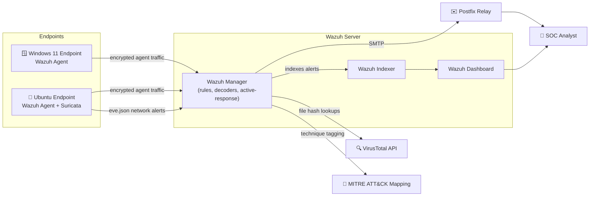

# Architecture

## Data Flow

## Components

| Component | Role |
|---|---|
| **Wazuh Agent** (Windows/Linux) | Lightweight agent shipping log, FIM, and syscheck events to the manager over an encrypted, authenticated channel |
| **Wazuh Manager** | Central brain — decodes events, evaluates them against rules (including custom rules in `local_rules.xml`), triggers integrations and active-response |
| **Wazuh Indexer** | Stores and indexes processed alerts for search and analytics |
| **Wazuh Dashboard** | Web UI for triage, threat hunting, MITRE ATT&CK views, and reporting |
| **Suricata** | Network IDS/IPS running on the Linux endpoint; writes alerts to `eve.json`, which the Wazuh agent tails as a JSON log source |
| **VirusTotal Integration** | The manager submits file hashes/paths from FIM events to VirusTotal; positive detections can trigger active-response |
| **Active-Response (Bash)** | Server-triggered script executed on the agent to remove a file confirmed malicious |
| **Postfix Relay** | Since Wazuh does not natively support authenticated SMTP, Postfix relays outbound mail through Gmail's SMTP over TLS with SASL auth |

## Why this layout

- **Agents stay thin.** All correlation, enrichment (VirusTotal, MITRE tagging), and response logic lives on the manager, so endpoints aren't doing heavy lifting.
- **Network and host telemetry share one pane of glass.** Suricata's `eve.json` is ingested as just another local log source on the Linux agent, so network alerts land in the same Wazuh Discover/Dashboard views as host-based alerts — no second console to check.
- **Response is opt-in and auditable.** The active-response script logs every action (success or failure) to `active-responses.log` before touching the filesystem, and requires an explicit `check_keys` handshake with the manager before it will delete anything.
